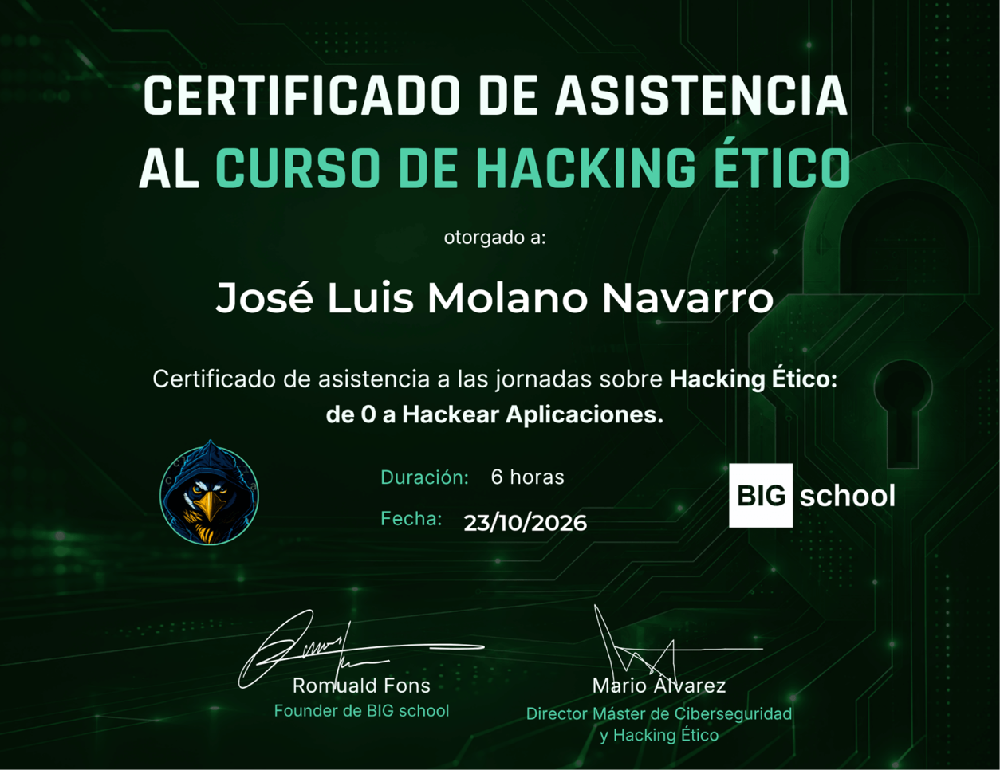

# Hola, soy José Luis, aunque me conocen como selu 👋

🎓 **Formación:** Desarrollo de Aplicaciones Web (DAW) y Administración de Sistemas Informáticos en Red (ASIR, en curso).

## 📖 Sobre mí

Desarrollo aplicaciones web y proyectos personales, entre ellos sistemas de gestión, una plataforma multijugador y herramientas de productividad. También trabajo con mi propia infraestructura y sigo aprendiendo sobre sistemas, despliegue y seguridad.

Busco una oportunidad en desarrollo Full Stack o DevOps donde aportar lo aprendido y seguir creciendo, con interés en explorar DevSecOps al completar ASIR.

---

## 🧭 Mis áreas

**💻 Devsel:** Full Stack · **⚙️ DevOpsel:** infraestructura · **🛡️ DevSecOpsel:** seguridad · **🧰 Herramientas**

---

##  Devsel · Desarrollo Full Stack

Proyectos de aplicaciones web y de escritorio.

<table>
<thead><tr><th width="33%">🛠️ Tecnologías</th><th width="33%">📁 Proyecto y descripción</th><th width="33%">📥 Descargar / 🌐 Ver</th></tr></thead>
<tbody>
<tr><td>🖥️ <strong>Front:</strong> React, TypeScript, Vite ⚙️ <strong>Back:</strong> Node.js, Express, TypeScript 🗄️ <strong>BBDD:</strong> PostgreSQL 🔧 <strong>ORM:</strong> Prisma</td><td><strong>Devsel-Trivia</strong> └─ 📝 Juego de preguntas con partidas individuales y multijugador en tiempo real</td><td><a href="https://trivia-app-frontend-self.vercel.app/">Ver aplicación</a></td></tr>
<tr><td>🖥️ <strong>Front:</strong> Vite, PDF.js ⚙️ <strong>Back:</strong> Tauri 2, Rust 🗄️ <strong>BBDD:</strong> SQLite</td><td><strong>Devsel-Traductor</strong> └─ 📝 Lector y traductor de PDF con IA. Requiere una clave de API y PDF con texto seleccionable; no incluye OCR.</td><td><strong>«Versiones de prueba»</strong> <a href="https://github.com/DevOpsel-Tech/Devsel-Traductor/raw/refs/heads/main/downloads/TraductorPDF-Windows-x64-setup.exe">Windows&#160;x64:&#160;instalador&#160;(.exe)</a> <a href="https://github.com/DevOpsel-Tech/Devsel-Traductor/raw/refs/heads/main/downloads/TraductorPDF-Windows-x64-portable.zip">Windows&#160;x64:&#160;portátil&#160;(.zip)</a> <small>Windows sin firma digital</small> <a href="https://github.com/DevOpsel-Tech/Devsel-Traductor/releases/download/android-prueba-b40cef6/TraductorPDF-Android-ARM64-prueba.apk">Android&#160;ARM64:&#160;instalador&#160;(.apk)</a> <small>Android con firma de depuración</small> <a href="https://github.com/DevOpsel-Tech/Devsel-Traductor/releases/download/macos-prueba-0.1.0/TraductorPDF-macOS-Apple-silicon-prueba.zip">macOS Apple silicon: descargar ZIP</a> <small>macOS sin firma ni notarización</small></td></tr>
<tr><td>🖥️ <strong>Front:</strong> Bootstrap 5 ⚙️ <strong>Back:</strong> PHP 🗄️ <strong>BBDD:</strong> MySQL</td><td><strong>Devsel-web-estetica</strong> └─ 📝 Web de servicios de estética con galería y formulario de contacto</td><td>Próximamente</td></tr>
</tbody>
</table>

---

##  DevOpsel · Infraestructura y DevOps

Proyectos de despliegue, sistemas y administración de infraestructura.

| 🛠️ Tecnologías | 📁 Proyecto y descripción | 📥 Descargar / 🌐 Ver |
|----------------|---------------------------|-------------------------|
| ⚙️ **Automatización:** Ansible 📦 **Orquestación:** Kubernetes, K3s | **DevOpsel-Ansible-k3s** └─ 📝 Infraestructura DevOps con Kubernetes | Próximamente |
| ⚙️ **Automatización:** Ansible ☸️ **Orquestación:** Kubernetes (K8s) | **DevOpsel-Ansible-k8s** └─ 📝 Automatización de Kubernetes con Ansible | Próximamente |
| ⚙️ **Automatización:** Ansible 🐳 **Contenedores:** Docker | **DevOpsel-Ansible-Docker** └─ 📝 Automatización de Docker con Ansible | Próximamente |

### 🏅 AWS Academy · Insignias y certificados

<table>
  <tr>
    <td align="center" valign="top">
      <strong>Microservices and CI/CD Pipeline Builder</strong>  
        
      
    </td>
  </tr>
</table>

<a href="https://www.credly.com/users/jose-luis-molano-navarro">🔗 Ver mis insignias verificables en Credly</a>

---

##  DevSecOpsel · DevSecOps / SecOps

Aprendizaje en seguridad defensiva, ofensiva y monitorización.

### 🔎 Áreas de interés

| Área | Tecnologías y líneas de trabajo |
|------|--------------------------------|
| 🛡️ Seguridad defensiva | Seguridad de redes, Fortinet y hardening de servidores |
| 🔍 Seguridad ofensiva | Fundamentos y prácticas iniciales |
| 📊 SOC y monitorización | Monitorización de seguridad, en exploración |

### 🏅 Certificado de hacking

<table>
  <tr>
    <td valign="top">
      

        
      

    </td>
    <td valign="top">
      <strong>🎯 En proyecto</strong>  
      AWS Certified Security – Specialty
    </td>
  </tr>
</table>

---

##  SysOps · Sistemas e infraestructura

Administración de sistemas, servidores, virtualización, mantenimiento y copias de seguridad.

| Área | Sistemas y tecnologías |
|------|------------------------|
| 🖥️ **Sistemas operativos** | Ubuntu Server LTS, Windows Server 2022 y Windows Server 2025 |
| 🖧 **Servidores y gestión remota** | Dell PowerEdge T140/T340/T440/T640, iDRAC 9 |
| 💾 **Virtualización y copias** | Proxmox VE, Proxmox Backup Server |
| 🗄️ **Administración de bases de datos** | MySQL, PostgreSQL, phpMyAdmin, pgAdmin 4, MySQL Workbench |

### 🏅 AWS Academy · Insignias y certificados

<table>
  <tr>
    <td align="center" valign="top">
      <strong>Cloud Foundations</strong>  
        
      
    </td>
    <td align="center" valign="top">
      <strong>Cloud Operations</strong>  
        
      
    </td>
  </tr>
</table>

<a href="https://www.credly.com/users/jose-luis-molano-navarro">🔗 Ver mis insignias verificables en Credly</a>

---

##  Herramientas y entorno de trabajo

Herramientas transversales de desarrollo y operación, separadas de la administración de infraestructura.

| Categoría | Herramientas utilizadas | 🔎 En exploración |
|-----------|-------------------------|-------------------|
| 🔧 **Editores e IDE** | VS Code, Cursor, Eclipse | IntelliJ IDEA, Android Studio |
| 🔀 **Control de versiones** | Git, GitHub, Gitea | — |
| 📦 **Contenedores y orquestación** | Docker, Portainer, K3s | Kubernetes (K8s) |
| ⚙️ **Automatización y despliegue** | Ansible | Semaphore, Argo CD |
| 🛡️ **Herramientas de seguridad** | — | Kali Linux, Burp Suite |

---

## 📧 Contacto

- Email: [jlmn85@outlook.es](mailto:jlmn85@outlook.es)
- LinkedIn: [José Luis Molano Navarro](https://www.linkedin.com/in/josé-luis-molano-navarro-580960283)

---

*Desarrollado con ❤️ por José Luis*
